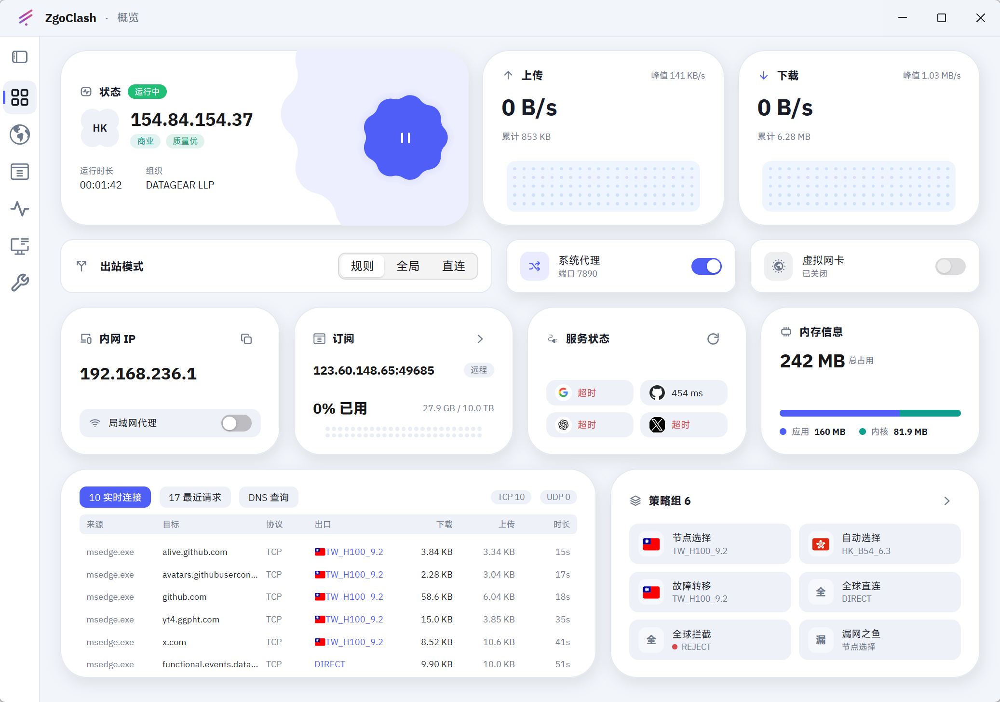

<p align="center">
  
</p>

# ZgoClash

> 一个用 [MyGo](https://github.com/egoist/mygo) 的 **Native UI** 写的 mihomo 客户端样例，
> 界面复刻了 [FlClash](https://github.com/chen08209/FlClash) 的设计。

## 这是什么

ZgoClash 是为了**验证 MyGo 的 native-ui 能力**而写的样例应用。

MyGo 除了能做网页壳，也能用 `package ui` 直接画原生界面 —— 没有 WebView，没有 HTML，
所有卡片、图表、开关、列表都是 Go 代码里的布局与绘制指令。ZgoClash 用它做了一个
真正能用的客户端：接管 mihomo 内核、管理订阅、切换节点、看实时连接。

也正因为如此，界面尽量照着 FlClash 复刻：同样的信息架构、同样的卡片节奏、同样的
配色与圆角，尽量把 MyGo 的绘制能力用到和 FlClash 同一水准。

界面能到这个程度，要**特别感谢 [FlClash](https://github.com/chen08209/FlClash)** ——
它的设计与实现是本项目最好的参照，图标、卡片布局、交互细节大多照着它来。

> 说明：本项目与 FlClash 及其作者无关，也不是官方项目，仅作为 MyGo native-ui 的
> 能力示例。

## 做到了什么

| 页面 | 内容 |
| --- | --- |
| 概览 | 出站模式、系统代理与 TUN 开关、上下行流量与点阵图、内网 IP、订阅流量、服务连通性、内存占用、实时连接、策略组 |
| 代理 | 按分组浏览节点，一键切换，延迟文字即测速按钮 |
| 订阅 | 订阅链接 / 本地文件 / 手动配置，可编辑名称与链接、同步、导出、删除 |
| 连接 | 实时连接列表，来源、目标、出口、时长、流量，查看详情与断开全部 |
| 日志 | mihomo 内核日志，过滤与自动滚动 |
| 设置 | 外观、启动行为、混合端口、外部控制端口、TUN 栈、延迟测试地址、订阅自动更新 |

另外：

- 托盘常驻，窗口最小化或收进托盘后**暂停轮询、释放缓存**，内核继续在后台工作；
- 节点名里没有表情时，自动补上所在国家的国旗；已经有了就不再重复标记；
- 窗口每次启动都居中，尺寸按显示器工作区自适应。

## 构建

需要 Go 1.27 与 MyGo 的工具链：

```bash
go tool mygo build      # 产物在 bin/windows-amd64/
go tool mygo dev        # 开发模式，改动自动热重载
```

## 目录

| 路径 | 内容 |
| --- | --- |
| `main.go` | 窗口、托盘与单实例 |
| `internal/app` | 设置、订阅与 mihomo 核心的生命周期 |
| `internal/engine` | mihomo 的封装与 REST 轮询 |
| `internal/ui` | 界面（概览、代理、订阅、连接、日志、设置） |
| `resources` | 应用图标与托盘图标 |
| `docs` | README 用到的截图 |

## 致谢

- [MyGo](https://github.com/egoist/mygo) —— 让原生界面的写法变得可以接受。
- [FlClash](https://github.com/chen08209/FlClash) —— 界面的参照与灵感来源。
- [mihomo](https://github.com/MetaCubeX/mihomo) —— 内核。
